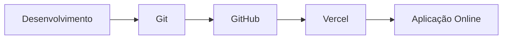
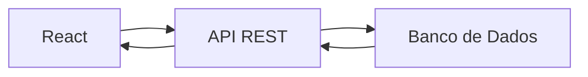

# 🚀 Frameworks Front-end - Resumo Geral da Disciplina


## 📖 Sobre a Disciplina

A disciplina de **Frameworks Front-end** apresenta os conceitos, ferramentas e práticas utilizadas no desenvolvimento de aplicações web modernas.

Durante as aulas foram explorados:

- 🌐 Desenvolvimento Front-end
- 🎨 Interfaces UX/UI
- ⚛️ Frameworks Modernos
- 🔗 Integração com APIs
- 🛠️ Criação de Serviços Back-end
- 📦 Versionamento com Git e GitHub
- 🚀 Publicação de aplicações na Vercel
- 📋 Gestão de Projetos

O objetivo principal foi compreender o ecossistema de desenvolvimento web moderno e aplicar os conhecimentos em projetos práticos.

---

# 📚 Conteúdo das Aulas

## 🏁 Aula 01 - Introdução a Frameworks Front-end

### 🎯 Objetivo
Apresentar os fundamentos do desenvolvimento front-end e a importância dos frameworks na construção de aplicações modernas.

### 📌 Conteúdos Abordados

- HTML
- CSS
- JavaScript
- UX (User Experience)
- UI (User Interface)
- Planejamento de Projetos
- Prototipação
- React
- Angular
- Vue.js

### ✅ Conceitos Principais

- Componentização
- Reutilização de código
- Organização de projetos
- Manutenção de aplicações
- Comunicação com APIs e Back-end

### 💻 Atividade Prática

Criar uma aplicação utilizando tecnologias web básicas, realizar o versionamento no GitHub e publicar na Vercel.

---

## ⚙️ Aula 02 - Configuração do Ambiente de Desenvolvimento

### 🎯 Objetivo

Preparar o ambiente necessário para desenvolvimento Front-end com React.

### 📌 Ferramentas Estudadas

- Visual Studio Code
- Node.js
- NPM
- package.json
- React

### 🔄 Controle de Versão

- Git
- GitHub
- Branches
- Tags
- Versionamento Semântico

### 🏷️ Semantic Versioning

```text
MAJOR.MINOR.PATCH
```

Exemplo:

```text
1.0.0
```

### 🚀 Fluxo de Publicação



### 💻 Atividade

Criar uma aplicação React, publicar no GitHub e disponibilizá-la online.

---

## 🖥️ Aula 03 - Projetos com Frameworks Front-end

### 🎯 Objetivo

Conhecer diferentes frameworks e bibliotecas utilizadas no mercado.

### 📌 Tecnologias Comparadas

- ⚛️ React
- 🟢 Vue.js
- 🔴 Angular
- ▲ Next.js

### ✅ Aprendizados

- Estruturas de projetos
- Diferenças entre frameworks
- Organização de código
- Compartilhamento de projetos

### 💻 Atividade

Clonagem e estudo de projetos utilizando Git.

---

## 🔗 Aula 04 - Consumo de APIs no Front-end

### 🎯 Objetivo

Integrar aplicações front-end com APIs REST.

### 📌 Conceitos Estudados

- Requisições HTTP
- Consumo de APIs
- Recebimento de dados
- Tratamento de respostas
- Tratamento de erros

### 🔄 Fluxo de Comunicação



### ✅ Benefícios

- Dados dinâmicos
- Comunicação com back-end
- Aplicações mais interativas

### 💻 Projeto

Aplicação React consumindo uma API REST.

---

## 🛠️ Aula 05 - Criação de APIs para o Front-end

### 🎯 Objetivo

Desenvolver serviços que fornecem dados para aplicações Front-end.

### 📌 Tópicos

- Construção de APIs
- Endpoints REST
- Back-end
- Testes com Postman
- Integração entre sistemas

### 🔄 Estrutura

```text
Front-end
      ↓
API REST
      ↓
Banco de Dados
```

### ✅ Vantagens

- Separação de responsabilidades
- Facilidade de manutenção
- Escalabilidade

---

## 📋 Aula 06 - Projetos Front-end

### 🎯 Objetivo

Aplicar conceitos de gestão e organização de projetos.

### 📌 Ferramentas Utilizadas

- GitHub Projects
- GitHub
- Git

### ✅ Aprendizados

- Planejamento de tarefas
- Organização de equipes
- Controle de progresso
- Colaboração em projetos

### 💻 Atividade

Gerenciamento de projeto utilizando GitHub Projects.

---

## 🎨 Aula 07 - Frameworks CSS

### 🎯 Objetivo

Explorar alternativas para estilização de interfaces.

### 📌 Tecnologias

#### CSS Tradicional

- CSS puro (Vanilla CSS)

#### Framework CSS

- Tailwind CSS

### ✅ Benefícios do Tailwind

- Desenvolvimento mais rápido
- Padronização visual
- Alta produtividade
- Componentes reutilizáveis

### 🎯 Comparação

| Vanilla CSS | Tailwind CSS |
|------------|-------------|
| Mais controle | Mais produtividade |
| Mais código | Menos código |
| Totalmente customizável | Classes utilitárias |

---

## ⚛️ Aula 08 - Projeto React

### 🎯 Objetivo

Desenvolver uma aplicação prática utilizando React.

### 📌 Conceitos Aplicados

- Componentes
- Interfaces dinâmicas
- Organização de projeto
- Publicação online
- Versionamento

### 💻 Projeto

Aplicação para gestão de atividades desenvolvida em React.

### 🚀 Tecnologias Utilizadas

- React
- GitHub
- Vercel

---

## 🚀 Aula 09 - Projeto React 02

### 🎯 Objetivo

Evoluir a aplicação criada anteriormente.

### 📌 Foco da Aula

- Consolidação dos conceitos React
- Evolução do sistema
- Organização do código
- Melhorias na aplicação

### 💻 Projeto

Aplicação de gestão de atividades contendo diversos conceitos estudados ao longo da disciplina.

> ℹ️ O README do projeto menciona a utilização de 11 conceitos, porém não detalha quais são eles.

---

# 📊 Síntese da Disciplina

Ao longo do curso foi possível evoluir dos conceitos básicos de desenvolvimento web para a construção de aplicações modernas utilizando frameworks front-end.

## 🧠 Conhecimentos Desenvolvidos

✅ HTML e CSS

✅ JavaScript

✅ React

✅ Vue.js

✅ Angular

✅ Next.js

✅ Git e GitHub

✅ Versionamento Semântico

✅ APIs REST

✅ Postman

✅ Tailwind CSS

✅ Deploy com Vercel

✅ Gestão de Projetos

---

# 🎯 Competências Desenvolvidas

- 💡 Desenvolvimento Front-end Moderno
- 🎨 Construção de Interfaces Responsivas
- 🔗 Integração com APIs
- 🛠️ Desenvolvimento e Consumo de Serviços
- 📦 Versionamento de Código
- 🚀 Publicação de Aplicações
- 👥 Colaboração em Equipe
- 📋 Gestão de Projetos de Software

---

# 🏆 Conclusão

A disciplina proporcionou uma visão completa do ecossistema de desenvolvimento Front-end moderno, abordando desde os fundamentos da web até a criação de aplicações React integradas a APIs, utilizando boas práticas de versionamento, colaboração e publicação.

O conjunto das atividades permitiu aplicar conhecimentos teóricos em projetos reais, aproximando o processo de aprendizagem das práticas adotadas no mercado de desenvolvimento de software.

---

## 👨‍💻 Autor

Desenvolvido como parte das atividades da disciplina não esqueça de deixar uma estrela no repositório!
